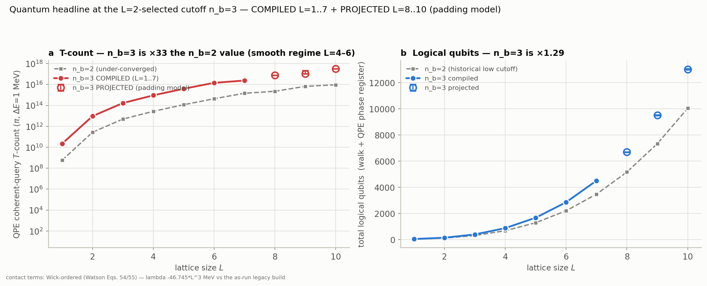
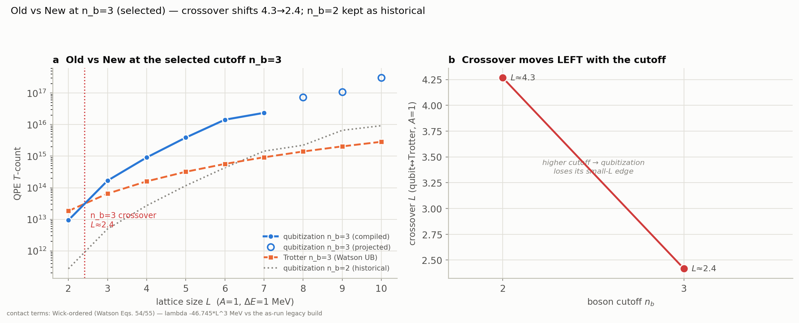
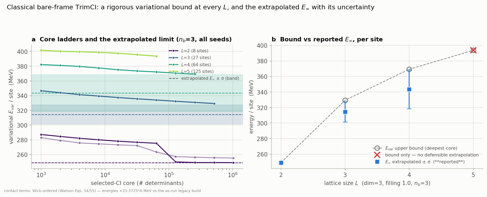

# NuQu — fault-tolerant resource estimation for a dynamical-pion nuclear EFT


**How expensive is it, in real fault-tolerant resources, to compute a nuclear ground-state
energy on a quantum computer?**

NuQu answers that end to end for Watson's *dynamical-pion* chiral effective field theory on a
3D lattice. It builds the mixed fermion–boson Hamiltonian with OpenFermion, block-encodes it,
compiles a **qubitized walk operator** through [pyLIQTR](https://pypi.org/project/pyLIQTR/),
and reports the T-count and logical-qubit width for quantum phase estimation — then benchmarks
that against the **Trotterized** cost bound from
[Watson et al., arXiv:2312.05344](https://doi.org/10.48550/arXiv.2312.05344).

Numbers here are *compiler-derived*, not asymptotic scaling arguments: where a row says
**compiled**, a circuit was actually built and counted.

The project runs two workstreams against **one** Hamiltonian: the quantum resource anchor above,
and a [classical selected-CI baseline](#classical-baseline--variational-upper-bounds-on-the-same-hamiltonian)
that returns rigorous variational upper bounds on the identical operator. A resource estimate
without that reference is unfalsifiable, so the classical side is not a side quest — it is what
makes the quantum number mean something.

> Started as a final project for Physics 765 (Quantum Algorithms & Error Correction, S26) and has
> been extended since toward a publication — 375 commits, Feb–Oct 2026. The original course
> deliverables (joint with a project partner) are included as
> [`Final_Report_PHYSICS765_05042026.pdf`](Final_Report_PHYSICS765_05042026.pdf) and
> [`Final Presentation - Friend & Ha.pdf`](Final%20Presentation%20-%20Friend%20%26%20Ha.pdf);
> essentially everything below postdates them.

---

## Quantum resource anchor

At the selected boson cutoff `n_b = 3`, A = 1 nucleon, ΔE = 1 MeV target precision:

| quantity | value | status |
|---|---|---|
| QPE coherent-query T-count, L = 1…7 | 2.21×10¹⁰ … 2.36×10¹⁶ | **compiled** |
| QPE coherent-query T-count, L = 10 | 3.05×10¹⁷ | projected + conditional |
| Total logical qubits, L = 1…7 | 40 … 4,506 | **compiled** |
| Total logical qubits, L = 10 | 13,032 (13,006 walk + 26 phase) | projected |
| Qubitization ↔ Trotter crossover | L ≈ 2.4 | compiled vs. analytic bound |
| Pauli one-norm λ ratio, n_b = 2 → 3 | ×3.75 | **compiled**, L-stable |
| Watson Table-IX reproduction | qubits 99,000 *exact*; T ×1.24 | **validation** |

Resource counts are **independent of nucleon number A** — the cost is set by the lattice and the
boson register, not by how many nucleons occupy it.



### The comparison does not favor qubitization



Raising the boson cutoff from `n_b = 2` to the physically-motivated `n_b = 3` multiplies the
qubitized T-count by **×33** (λ grows ×3.75, per-step cost ×8.9) while Watson's Trotter bound grows
only ~×5. The crossover therefore moves **left**, from L ≈ 4.3 to L ≈ 2.4: at the selected cutoff
**Trotterization is cheaper everywhere above L ≈ 2.4**, and qubitization wins only at the smallest
lattice.

This is reported as an *architecture comparison under a stated scenario*, not a superiority claim
in either direction. The Trotter side is a **loose analytic upper bound**; tightening it moves the
crossover further left, never back. The honest contribution is the compiled pipeline and the
cutoff-dependence of the ranking — not a win.

### What the numbers exclude

"Total logical qubits" means the walk/block-encoding register **+** the QPE phase register
`m = ⌈log₂(N_walk/2)⌉`. It **excludes** input-state preparation (which is not additive — state prep
runs and resets before the phase register is populated), magic-state factories, and routing.
L = 8–10 are extrapolated with a quantization-aware padding model (`pyLIQTR` pads PREPARE to
`2^⌈log₂ terms⌉`), back-tested to **< 1.1 %** on the compiled L = 1…7 points. The `n_b = 3` cutoff
was selected at L = 2; its adequacy at L = 10 is corroborated but **not established**.

---

## Classical baseline — variational upper bounds on the same Hamiltonian

A quantum resource estimate only means something against a classical reference solving the *same*
operator. `classical/trimci/hamiltonian.py` imports the quantum side's own
`build_eft_hamiltonian`, so the selected-CI solver and the block encoder are handed a
bit-identical truncated Hamiltonian — same lattice, same boson cutoff, same contact convention.
No separate model, no re-derivation.

The solver is a selected-CI ("TrimCI"-style) expansion–trim cycle over the mixed fermion–boson
Fock space, with a matrix-free `H_ij` evaluator, an Epstein–Nesbet PT2 correction, and a C++
sparse-Davidson backend. At every lattice size it returns a **rigorous Ritz variational upper
bound** — valid whether or not the ladder converged, and independent of any extrapolation or
error-bar convention.

`n_b = 3`, bare frame, filling 1.0 (A = L³ nucleons), Wick contact convention:

| L | sites | nucleons | deepest core (dets) | E_var bound (MeV) | /site | wall |
|--:|--:|--:|--:|--:|--:|--:|
| 2 | 8 | 8 | 1,024,000 | 1,993 | 249.1 | 2.1 h |
| 3 | 27 | 27 | 512,000 | 8,894 | 329.4 | 4.9 h |
| 4 | 64 | 64 | 256,000 | 23,636 | 369.3 | 12.1 h |
| 5 | 125 | 125 | 64,000 | 49,211 | 393.7 | 8.2 h |



Panel **a** is the rigorous content: the core ladders, and where each stops descending. The
extrapolated band in panel **b** is drawn under an error-bar convention that has since been
superseded (see *Open* below) — read the bounds, not the error bars.

Calibration is anchored on the one point that is **exact**: at A = 0 the Hamiltonian is a free
pion field, diagonalizable in closed form by a multimode Bogoliubov transformation, giving
**304.149 MeV/site at L = 2** and **331.461 at L = 3**. Every truncated limit, in any frame or
cutoff, must lie at or above it — which makes A = 0 a genuine falsification test rather than a
self-consistency check.

### Cross-validation found a real failure

An independent **block2 DMRG** calculation on the identical truncated Hamiltonian (L = 2, n_b = 3)
returned a *lower* variational energy than the selected-CI search at every nucleon number tested —
decisively at **A = 4** (275.573 vs 276.62 MeV/site) and **A = 8** (248.247 vs 249.07), where the
search had simply missed a better basin while its own seed spread read 0.000.

That is a negative result about our own solver, and it was the most useful thing the classical
side produced: it established that agreement between two estimators fitted to the same ladder is
*not* evidence of correctness. The uncertainty convention was replaced with a gated one that
refuses to report an extrapolated limit sitting above any same-operator variational bound,
checked against an external registry of DMRG energies
([`classical/trimci/external_bounds.json`](classical/trimci/external_bounds.json)).

### Frame preconditioning

Solving in a per-mode squeezed (Bogoliubov) frame reaches a fixed reference energy with
**64–256× fewer selected determinants**, and the advantage grows with L. This is a compaction
result about the classical workflow — not exact-E₀ recovery, not finite-cutoff isospectrality,
and not an asymptotic speedup: the bare calculation keeps improving with determinant count.

### Open

The **bounds above are settled**; the extrapolated `E_∞` and its σ are not. That convention is on
its third revision, several cells currently report a bound only, and the DMRG calibration showed
the previous error bars were 3.6–396× too small. Treat any extrapolated classical limit in this
repo as provisional. Cost growth in this solver is likewise an observation about *this*
implementation — not evidence of classical intractability, which would need controlled
comparisons against QMC, tensor networks and other selected-CI codes that have not been run.

---

## Install

Requires **Python 3.10.x** — pyLIQTR 1.3.4 and its pinned dependencies do not support 3.12+.

```bash
git clone https://github.com/brandonnfriend/NuQu.git
cd NuQu

python3.10 -m venv .venv
source .venv/bin/activate          # Windows: .venv\Scripts\activate
pip install -r requirements.txt
```

`requirements.txt` is deliberately minimal — it covers the quantum resource-estimation path only.
The classical solvers pull heavier optional backends (block2 for DMRG, PySCF, NetKet); see
`hpc/dmrg/requirements-hpc.txt` and `hpc/detsvsL/requirements-hpc.txt`.

## Reproduce

```bash
# Quantum resource sweep (defaults: L=2, dim=3, A = 1..100 sparse)
python run_nucleon_sweep.py --label smoke

# Plot a saved sweep — set the input path and pick a plotting function inside
python plot_sweep_data.py

# Logical-qubit accounting check
python -m tests.test_logical_qubits
```

Output lands in `data/<date>/`, with figures alongside. **Keep `L ≤ 2` locally** —
`run_nucleon_sweep.py:get_L_for_A` is pinned to 2 for exactly this reason. Paper-grade `L` is an
HTCondor campaign, not a laptop run (`hpc/`).

## Repo map

| path | what it is |
|---|---|
| `src_PI/hamiltonians/` | The EFT Hamiltonian: lattice geometry, pion basis (Fock / amplitude / squeezed), vertex and contact terms |
| `src_PI/estimation/` | Block encoders (PauliLCU, sparse oracle, LOBE), qubitized walk, QPE cost model, λ normalization |
| `src_PI/estimation/hardware/` | Logical → physical translation: code distance, factory count, wall-clock runtime |
| `src_PI/trotter_theory/` | Watson's Trotter bound, reproduced term-by-term against his Table IX |
| `classical/trimci/` | Selected-CI ("TrimCI"-style) solver over the mixed fermion–boson Fock space — the classical baseline |
| `classical/baselines/` | Independent cross-checks: block2 DMRG, coupled cluster, NetKet NQS, sign-structure analysis |
| `misc/` | Campaign drivers, figure generators, aggregation and manifest-validation tooling |
| `hpc/` | HTCondor submit/run scripts for the cluster campaigns |
| `tests/` | 330 tests — physics invariants, compiled-resource regressions, convention guards |
| `assets/` | Figures used in this README |

Working notes — `PROJECT_CONTEXT.md`, `REMEDIATION_PLAN.md`, `CLAUDE.md`,
`classical/trimci/TODO.md` — are the project's lab notebook: live state, open questions, audit
trail and claim discipline. They are deliberately unpolished and record what is *not* yet settled
as carefully as what is. `data/`, `results/`, `docs/` and the manuscript are gitignored.

## Tests

```bash
python -m pytest -q                  # everything (330 tests)
python -m pytest -q -m "not slow"    # skips the 5 tests marked slow
```

`slow` is **opt-out, never opt-in**, so nothing silently stops running. Tests encode physics, not
just plumbing — operator algebra for the vertex terms, Wick ordering of the contact interaction,
the power-of-2 walk quantization invariant, and guards that pyLIQTR never silently falls back to a
dense `MatrixGate` at the counting boundary.

See [`tests/README.md`](tests/README.md) for tiers, measured runtimes and known-warning notes.

## How claims are controlled

Every reported number carries a label — *compiled*, *projected*, *variational*, *extrapolated*,
*empirical*, *diagnostic*, *conditional* — and nothing outside that frozen map counts as a result.
Claims that did not survive scrutiny are recorded as **withdrawn** rather than quietly dropped.
Concretely:

- the DMRG calibration above refuted our own error bars and forced a replacement convention;
- a missing Wick prescription on the contact terms was found and corrected in closed form;
- resource runs are tied to data by SHA-256 manifests, re-verifiable from outside the pipeline
  (`misc/verify_accepted_manifests.py`).

That machinery lives in the gitignored `results/` tree and is summarized in the manuscript.

## Background

- **Model + Trotter baseline** — Watson et al., [arXiv:2312.05344](https://doi.org/10.48550/arXiv.2312.05344)
- **Qubitized walks / QPE compilation** — [pyLIQTR](https://pypi.org/project/pyLIQTR/)
- **Hamiltonian construction** — [OpenFermion](https://github.com/quantumlib/OpenFermion)
- **Selected CI** — Zhang & Otten, [arXiv:2511.14734](https://arxiv.org/abs/2511.14734)
- **DMRG cross-check** — [block2](https://github.com/block-hczhai/block2-preview)
- **Bosonic cutoff theory** — Tong, Albert, McClean, Preskill & Su, [arXiv:2110.06942](https://arxiv.org/abs/2110.06942)
- **Prior classical work on dynamical pions** — Madeira, Lovato, Pederiva & Schmidt, [arXiv:1803.10725](https://arxiv.org/abs/1803.10725) (quantum Monte Carlo; this project does not claim priority for a classical treatment of the model)

## Status

Active research. The quantum anchor and the Trotter comparison are frozen; the classical
uncertainty convention and the large-volume cutoff argument are the open threads. A manuscript is
in preparation — until it appears, treat the conditional rows above as conditional.

## Citation

Manuscript in preparation. For now, cite the repository:

```bibtex
@software{friend_nuqu,
  author = {Friend, Brandon},
  title  = {NuQu: fault-tolerant resource estimation for a dynamical-pion nuclear EFT},
  url    = {https://github.com/brandonnfriend/NuQu},
  year   = {2026}
}
```

## License

MIT — see [LICENSE](LICENSE).
